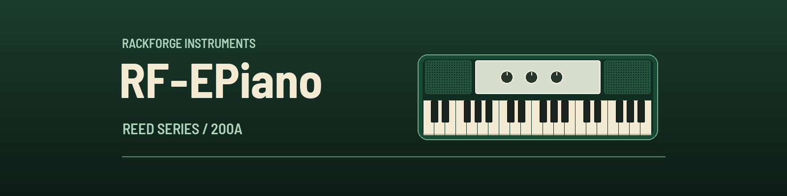

# RF-EPiano



RF-EPiano is a physically modelled 200A electric piano for RackForge, powered
by the original [OpenWurli DSP](https://github.com/hal0zer0/openwurli).
It ships as one portable `.rfplugin`, with no sample banks or external resources.

## Install

Download `RF-EPiano.rfplugin` from the [latest release](https://github.com/kalexis1994/rackforge-plugin-rf-epiano/releases/latest).
Install it from RackForge's **Plugin Manager**, open **PLAY**, and select
**RF-EPiano**. Version 0.1.4 was tested with RackForge 0.1.25 on Windows.
The panel requires a host that supports portable WASM plugins and the shared
program selector.

## Play

Use **Program memory** to step through the five factory
programs or open the searchable list by selecting the program name. The panel
uses RackForge's shared program selector. To save a personal variation, use
**PLAY → Presets → New preset**. RackForge captures the current state and
can export or import it as an `.rfpreset`.

The three controls are:

| Control | Initial value | What it does |
| --- | ---: | --- |
| Volume | 80% | Turns the original circuit's volume pot. |
| Tremolo | 50% | Sets the depth of the modelled Twin-T and LED/LDR tremolo. |
| Speaker | 0% | Moves from direct output to the modelled speaker cabinet. |

The factory bank also includes **200A Direct** (tremolo off, speaker bypassed),
**200A Cabinet** (tremolo off, speaker at 100%), and **200A Cabinet Tremolo**
(tremolo at 65%, speaker at 100%). **200A Bark** starts at 70% volume with
both tremolo and speaker off. It scales the modelled reed swing at the pickup by 1.5
to bring out stronger harmonics on firm strikes.

The original 64-key note range, sustain pedal, voice behaviour, smoothing,
and +14 dB output alignment are retained. The mono engine is sent equally
to both output channels. The experimental MLP correction is off, as in the
upstream default. Saved programs include all three controls and the selected
voicing. Earlier RF-EPiano states load with the original voicing.

## Build and verify

The SDK and runtime revisions in `Cargo.lock` match RackForge 0.1.25 at
`7a14c68aa208290587d985d606b0dbc17600ee07`. The manifest uses Plugin API 1.11.
For a source build, use Rust 1.98 and the `wasm32-unknown-unknown` target.
On Windows, the following uses the MSVC toolchain and an adjacent RackForge
checkout. The same build script accepts an existing `-StoreExecutable`.

```powershell
rustup target add --toolchain 1.98.0-x86_64-pc-windows-msvc wasm32-unknown-unknown
./tools/build-package.ps1 -Toolchain 1.98.0-x86_64-pc-windows-msvc
cargo +1.98.0-x86_64-pc-windows-msvc test -p rackforge-rf-epiano --release --locked --tests
```

The test first needs the WASM build. Set `RF_EPIANO_COMPONENT` to a packaged
or installed `component.wasm` to verify the final bytes. It compares output
against the unmodified upstream DSP with sample-positioned MIDI, sustain and
all three controls. It also exercises state restore and bounded reset. The
allocation test covers processing notes, pedal events and repeated resets.

The PLAY panel uses green enamel and brushed aluminum inspired by vintage
200A instruments. The dials respond to vertical or horizontal
dragging, a tap around the scale, and the keyboard. Barlow Semi Condensed is
bundled in the package under the SIL Open Font License.

The checked-in artwork is reproducible with `python tools/branding.py`
(Pillow 12+). `tools/check-panel.py` checks the PLAY surface in a browser
against a fixture using RackForge's iframe protocol (Python Playwright). It uses
the shared selector from the adjacent host web build. Pass `--kit` to test with
another compiled `program-select.js`.

The installable package is WASM-only. No native library or operating-system
audio device access is required. The first build has been exercised on a
Windows host; real-time performance on smaller targets is not yet measured.

## Sources and license

RF-EPiano is GPL-3.0-or-later. The source archive contains the complete
adapter, package assets, build and test tools, and the vendored OpenWurli DSP.
The linked dependencies are available at the
[pinned RackForge SDK revision](https://github.com/kalexis1994/rackforge/tree/7a14c68aa208290587d985d606b0dbc17600ee07/crates/rackforge-plugin-sdk)
and the
[pinned melange-primitives revision](https://github.com/hal0zer0/melange/tree/7ecb36c7e237c66929a39f936734b8b5a63f128d).
See [OpenWurli provenance](vendor/openwurli-dsp/UPSTREAM.md) and
[package notices](package/notices/NOTICE.txt).
